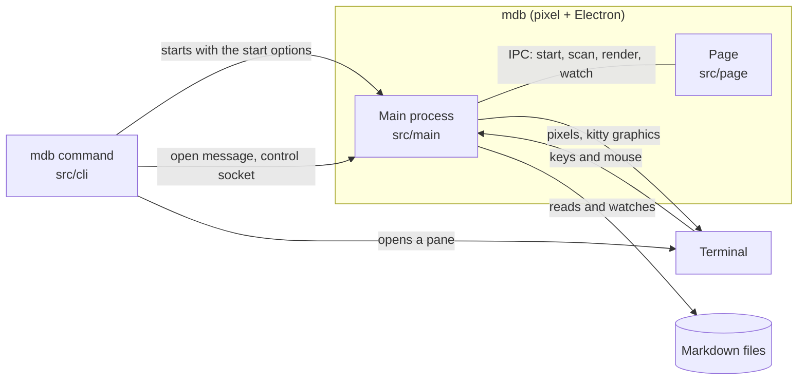

# mdb architecture

This document tells you how mdb works. Read it before you change the code.

## Overview

mdb is an Electron app that draws into a terminal. It does not open a window. The [pixel](https://github.com/zenbu-labs/terminal-browser/tree/main/pixel) library runs Electron, draws each frame of the app as pixels, and sends the pixels to the terminal with the kitty graphics protocol. pixel also sends the keys and the mouse events from the terminal to the app.

The app has one web page. The page shows the tab bar, the file list (the "finder"), and the documents (the "reader"). The Electron main process reads the files, makes the HTML, and watches the files. The `mdb` command starts mdb, or sends a document to an mdb that is open.

mdb has three parts. Each part runs in a different process:

| Part         | Folder     | Process                                     | Job                                                                                  |
| ------------ | ---------- | ------------------------------------------- | ------------------------------------------------------------------------------------ |
| CLI          | `src/cli`  | Node, for each `mdb` command                | Reads the arguments. Starts mdb here, opens a pane, or sends the document to an mdb. |
| Main process | `src/main` | Electron main process, started by pixel     | Reads and renders files, watches files, serves the control socket, shows the menu.   |
| Page         | `src/page` | Electron renderer, a WebView in the main UI | Shows the tabs, the finder, and the reader. Handles the keys.                        |

Two folders hold code for more than one part:

- `src/core` holds logic that does not use Electron or the DOM, for example scan, filter, search, render, frontmatter, links, arguments, and the instance registry. The CLI and the main process use it. The unit tests in `test/` test it.
- `src/shared/types.ts` holds the types that the processes send to each other.

## Start mdb

1. `bin/mdb.js` loads `dist/cli/main.js` and calls `main(argv)`.
2. `parseArgs` (`src/core/args.ts`) makes a `Launch`. A `Launch` holds the start options (`StartOptions`: the folder, the file, the background, the heading, and the terminal tab), and the pane options (`--split`, `--size`, `--new`, `--replace`).
3. `chooseAction` (`src/cli/launch.ts`) chooses one of three actions:
   - **here**: stdout is a terminal and there is no `--split`. The CLI starts pixel with the package folder and the start options as JSON. pixel starts Electron with `dist/main/main.js`.
   - **reuse**: the CLI opens a file, a running mdb shows the same terminal tab, and there is no `--new`. The CLI sends the file to that mdb. Read [Panes and the control socket](#panes-and-the-control-socket).
   - **split**: in all other cases, the CLI asks the terminal for a new pane. The new pane runs `mdb` with the same options and a hidden `--tab` argument. If stdout is not a terminal (an agent's shell), the CLI acts as if you gave `--split right`.
4. In the main process, `src/main/main.tsx` reads the start options. It makes the pixel root, and shows the page in one transparent `WebView`.
5. The page (`src/page/app.ts`) gets the start options with `window.mdb.start()`. It makes the first tab, and opens the file or the finder.

## The page

The page is a plain DOM app. It does not use a framework. esbuild bundles `src/page/app.ts` into `dist/page/app.js`. The page has no Node access. It speaks to the main process only through the `window.mdb` bridge (`MdbBridge` in `src/shared/types.ts`), which `src/main/preload.ts` makes.

| File                    | Job                                                                                                           |
| ----------------------- | ------------------------------------------------------------------------------------------------------------- |
| `app.ts`                | Applies the terminal colors, makes the tabs, and sets `window.mdbRemote` for the control socket.              |
| `tabs.ts`               | The tab bar, the list of tabs, the tab keys, file watching for all the tabs, and the routing of remote opens. |
| `tab.ts`                | One tab: a pane with its own folder, one reader, and a finder that it makes when it needs one.                |
| `tab-route.ts`          | Decides where a remote open goes: switch to a tab, use the front tab, replace, or add a tab.                  |
| `tab-labels.ts`         | The name on each tab: the document title, and the file name or the folder when two tabs have the same title.  |
| `finder.ts`             | The file list: filter, text search, and the selection.                                                        |
| `reader.ts`             | The document: outline, find, history, live reload, links, the status line, and the scroll keys.               |
| `find.ts`, `history.ts` | Find matches in text, and back and forward history.                                                           |
| `copy-code.ts`          | The copy button on code blocks.                                                                               |
| `style.css`             | All the styles. The colors come from CSS variables that `src/core/theme.ts` makes from the terminal colors.   |

### Tabs

Each tab is a `.tab-pane` element in `.tab-body`. All the panes are in the same position, one on top of the other. A tab that you do not see has the class `background`, which sets `visibility: hidden`. mdb does not use `display: none`, because the reader of a background tab must keep its layout. Then a live reload keeps the scroll position.

Many finders and readers can exist at the same time. Thus they obey these rules:

- Each finder and reader has a `window` key listener. The listener does nothing when `isActive()` is false. Only the front tab is active.
- `CSS.highlights` (the find highlights) is shared by the whole page. Only the active reader paints it. When a tab comes to the front, its reader paints its own matches again.
- The reader does not watch files and does not set `document.title`. It calls `onState()`, and `tabs.ts` does these jobs for all the tabs.
- `tabs.ts` handles `ctrl+t`, `ctrl+w`, `ctrl+h`, and `ctrl+l` in the capture phase. Thus the keys never get to a text field. For example, `ctrl+h` in a text field does not delete a character.

## Render a document

1. The reader calls `window.mdb.render(path)`.
2. The main process runs `loadDoc` (`src/core/render.ts`):
   1. `splitFrontmatter` removes the YAML frontmatter.
   2. markdown-it makes HTML. Its plugins add footnotes, task lists, and heading ids. highlight.js colors the code. A `mermaid` code block becomes `<pre class="mermaid">`.
   3. The frontmatter becomes a property list at the top.
   4. sanitize-html removes unsafe HTML. Relative image paths become `file://` URLs.
   5. The result is a `RenderedDoc`: the path, the title, the HTML, and the outline.
3. The reader puts the HTML in the page. Then it draws each Mermaid block with Pele, adds the copy buttons, makes the outline, and goes to the anchor or the heading.

The title comes from `titleOf` (`src/core/scan.ts`): the frontmatter `title`, else the first level-1 heading, else the file name. The finder rows and the tab labels use the same title.

## Find files

- `scanDocs` (`src/core/scan.ts`) finds the markdown files in a folder. It obeys `.gitignore` files, and skips dot folders, `node_modules`, and the `Library` folder of your home folder. It stops at 5,000 files.
- `filterDocs` (`src/core/filter.ts`) gives a score to the file names and titles for the text that you type.
- `searchDocs` (`src/core/search.ts`) searches the text in the files.

The main process keeps one scan for each folder. Each tab can have a different folder. While a tab shows its finder, `FolderWatchers` (`src/main/watcher.ts`) watches the folder of that tab. When a markdown file is added, renamed, or deleted, the finder scans again and keeps the query and the selection. The finder also scans again each time it comes back into view.

## Live reload

The page sends the paths of all the open documents with `window.mdb.watch(paths)`. `DocWatchers` (`src/main/watcher.ts`) keeps one file watcher for each path. When a file changes, the main process sends `mdb:changed` to the page. Each reader that shows that file renders it again, and keeps its scroll position. If the reader is in a background tab, the tab gets a dot.

## Panes and the control socket

An mdb that an agent opens must be easy to find again. Two parts make this possible: the instance registry, and the control socket.

- **Registry** (`src/core/registry.ts`): each running mdb writes `<pid>.json` in `~/.local/state/mdb/instances` (or `$XDG_STATE_HOME/mdb/instances`). The record has the process id, the socket path, and the terminal tab. `listInstances` removes the records of processes that stopped.
- **Control socket** (`src/core/control.ts`): each mdb listens on `<pid>.sock` in the same folder. A message is one line of JSON. The open message is `{cmd: "open", path, root, heading, mode}`. `openRequest` fills in `root` and `mode` for a message from an older mdb.
- **Ready**: mdb writes its record only after the page calls `window.mdb.ready()`. Thus the CLI never finds an mdb that cannot open a document yet.

When the main process gets an open message, it calls `window.mdbRemote.open()` in the page. `routeOpen` (`src/page/tab-route.ts`) then decides what to do, in this order:

1. If a tab shows the file, go to that tab.
2. If the front tab shows its finder, open the file in that tab.
3. With `--replace`, open the file in the front tab.
4. If not, open the file in a new tab.

The reply tells the CLI what occurred. The CLI prints the line from `reuseLine`.

To find the caller's pane and open a new pane, the CLI uses `@zenbu-labs/pixel/terminal`. The terminal tab is the cmux workspace, or the tab id that the terminal gives. In cmux, an mdb that you start yourself also knows its tab, from `CMUX_WORKSPACE_ID`.

## The agent skill

`skill/SKILL.md` tells Claude Code and Codex how to use mdb. `mdb skill install` (`src/cli/skill.ts`) copies it to `~/.claude/skills/mdb/SKILL.md` and `~/.codex/skills/mdb/SKILL.md`. The Codex copy also gets `skill/codex-note.md` at the top. The install adds a marker comment. It does not change a skill file that does not have the marker.

## Build

`scripts/build.mjs` uses esbuild to make four bundles in `dist/`:

| Bundle                 | Source                | Runs in                                  |
| ---------------------- | --------------------- | ---------------------------------------- |
| `dist/cli/main.js`     | `src/cli/main.ts`     | Node, from `bin/mdb.js`                  |
| `dist/main/main.js`    | `src/main/main.tsx`   | The Electron main process, through pixel |
| `dist/main/preload.js` | `src/main/preload.ts` | The page, before the page scripts        |
| `dist/page/app.js`     | `src/page/app.ts`     | The page                                 |

The build also copies `index.html` and `style.css` to `dist/page/`. `dist/` is not in git. `pnpm build` makes it, and `pnpm publish` builds it before it publishes.

## Security

- The page shows HTML from markdown files. sanitize-html removes scripts and unsafe attributes.
- `index.html` has a Content Security Policy. Scripts can only come from the page's own files.
- `lockNavigation` (`src/main/navigation.ts`) stops all navigation away from the page. Links go through `classifyLink` (`src/core/links.ts`). A web link opens in your default browser. A different local file opens in Finder.
- The page does not have Node access. The bridge gives it only the calls in `MdbBridge`.

## Tests and tools

| Tool                                               | What it checks                                                                                                                                                                                 |
| -------------------------------------------------- | ---------------------------------------------------------------------------------------------------------------------------------------------------------------------------------------------- |
| `pnpm test`                                        | Unit tests (vitest) in `test/`. They test `src/core`, the CLI logic, the file watchers, and the pure page modules.                                                                             |
| `pnpm tophat:all`                                  | Opens the real page offscreen in Electron and runs the scripts in `tophat/`: keys, clicks, file writes, page checks with expected values, and screenshots. The output goes to `build/tophat/`. |
| `pnpm smoke`                                       | Starts mdb in a pseudo-terminal for 6 seconds. It makes sure that mdb stays open, sends kitty graphics, and writes no errors.                                                                  |
| `pnpm typecheck`, `pnpm lint`, `pnpm format:check` | TypeScript, oxlint, and oxfmt.                                                                                                                                                                 |

For how to use these tools, read [Testing mdb](testing.md).

tophat (`src/dev/tophat.ts`) uses the real IPC handlers from `src/main/ipc.ts`, but not pixel. Thus it tests the page and the main process logic, but not the drawing in the terminal or the terminal keys. Use `pnpm smoke` and a real terminal for those.
