# Markdown showcase

This document shows each markdown item that mdb can show. Open it with this command:

```sh
mdb docs/showcase.md
```

Press `ctrl+b` to see the outline. Press `/` to find text.

## Headings

### Level 3 heading

#### Level 4 heading

##### Level 5 heading

###### Level 6 heading

The outline shows levels 1, 2, and 3.

## Text

This is a paragraph with **bold text**, _italic text_, **_bold and italic text_**, ~~text with a line through it~~, and `inline code`.

This line ends with two spaces,  
so the next text starts on a new line.

Use a backslash to show a markdown character as text: \*not italic\*, \# not a heading.

<kbd>ctrl</kbd> + <kbd>b</kbd> shows a key. H<sub>2</sub>O has a subscript. E = mc<sup>2</sup> has a superscript. <ins>This text is inserted.</ins>

---

The line above is a horizontal rule.

## Links

| Link                        | Example                                                                            |
| --------------------------- | ---------------------------------------------------------------------------------- |
| A heading in this document  | [Go to Tables](#tables)                                                            |
| A different document        | [Usage guide](usage.md)                                                            |
| A heading in a document     | [Outline, in the usage guide](usage.md#outline)                                    |
| A document that is missing  | [Missing page](showcase/missing.md)                                                |
| A file that is not markdown | [package.json](../package.json)                                                    |
| A web page                  | [The mdb pull request](https://github.com/jameswritescode/markdown-browser/pull/1) |
| An email address            | [Email](mailto:someone@example.com)                                                |
| A web address as text       | https://github.com/obsidianmd/pele                                                 |

## Lists

- An item
- An item with a nested list:
  - A nested item
  - A nested item with a nested list:
    - A third level
- A last item

1. The first step
2. The second step
   1. A nested step
   2. A nested step
3. The third step

A numbered list can start at a different number:

5. This list starts at 5
6. And continues at 6

### Task list

- [x] Write the showcase
- [x] Add diagrams
- [ ] Read all of it

## Quotes

> This is a quote.
>
> > This is a quote in a quote.
>
> A quote can contain **formatting**, `code`, and lists:
>
> - one
> - two

## Alerts

> [!NOTE]
> Useful information that users should know.

> [!TIP]
> Helpful advice to do a task better.

> [!IMPORTANT]
> Necessary information to do a task.

> [!WARNING]
> Information that needs attention immediately.

> [!CAUTION]
> Information about risks or bad results of an action.

## Code

A code block with no language:

```
plain text
  keeps its spaces
```

TypeScript:

```ts
interface Doc {
  path: string;
  title: string;
}

export function titleOf(doc: Doc): string {
  return doc.title || doc.path.split("/").pop()!;
}
```

Shell:

```sh
pnpm add -g ~/code/markdown-browser
mdb docs/showcase.md --solid
```

JSON:

```json
{ "name": "mdb", "private": true, "bin": { "mdb": "bin/mdb.js" } }
```

Python:

```python
def greet(name: str) -> str:
    return f"Hello, {name}!"
```

CSS:

```css
.markdown-body h1 {
  border-bottom: 1px solid var(--hairline);
}
```

A diff:

```diff
- const outline = window.innerWidth >= 760;
+ let outlineShown = false;
```

A long line scrolls to the side: `const message = "This is a very long line of text in a code block. It is longer than the width of the page, so you can scroll it to the side.";`

```js
const message =
  "This is a very long line of text in a code block. It is longer than the width of the page, so you can scroll it to the side.";
```

## Tables

| Left aligned | Centered | Right aligned |
| :----------- | :------: | ------------: |
| apple        |   red    |          1.20 |
| banana       |  yellow  |          0.50 |
| cherry       |   red    |         12.00 |

A table with formatting in its cells:

| Key      | Action                        |
| -------- | ----------------------------- |
| `/`      | Find text in the document.    |
| `ctrl+b` | Show or hide the **outline**. |
| `esc`    | Go back to the _file list_.   |

## Images

A local image, with a path from the folder of this document:


A remote image:


An image that is missing:


## Footnotes

mdb uses Pele to draw diagrams.[^pele] It uses pixel to show the page in the terminal.[^pixel]

[^pele]: Pele is the Mermaid renderer from the Obsidian team.

[^pixel]: pixel is the library that terminal-browser uses.

## HTML

<details>
<summary>Click to show more text</summary>

This text is hidden until you open it. It can contain **markdown**.

</details>

<p align="center">This paragraph is centered with HTML.</p>

mdb removes scripts from HTML. This script does nothing:

<script>document.body.style.background = "red";</script>

## Diagrams

### Flowchart

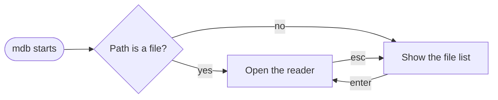

### Sequence diagram

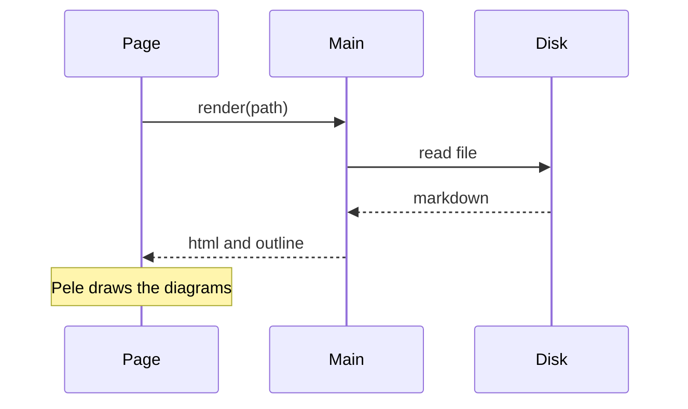

### Class diagram

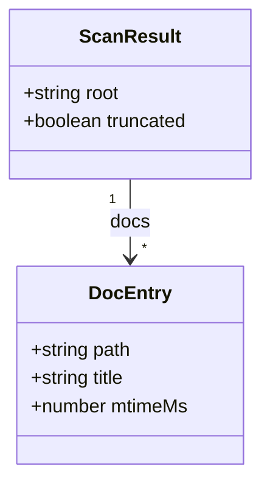

### State diagram

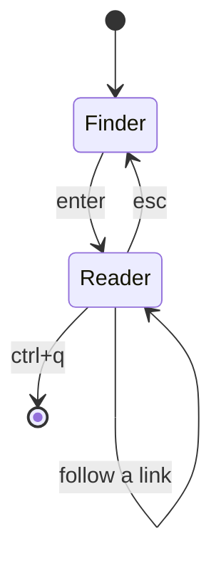

### Entity relationship diagram

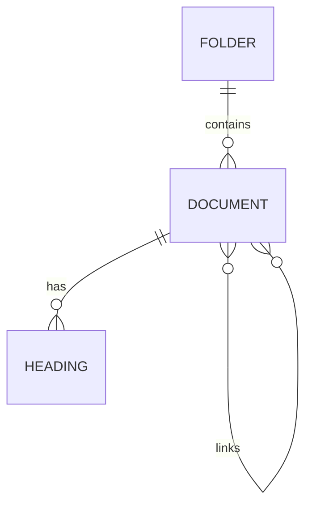

### Gantt chart

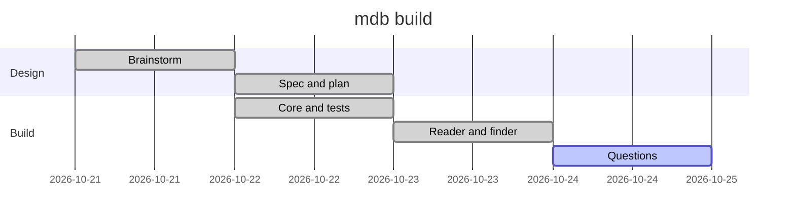

### Pie chart

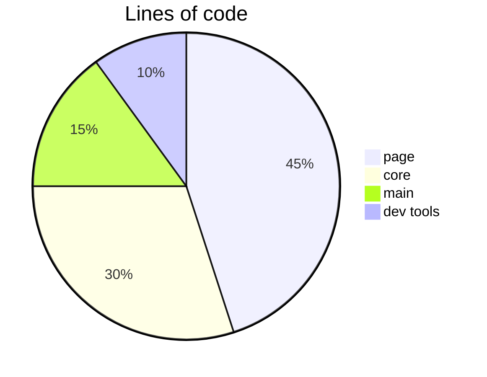

### Git graph

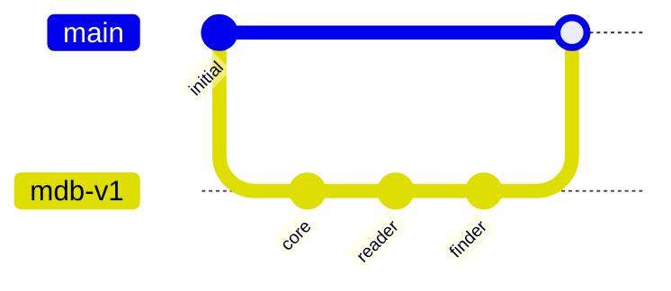

### Mind map

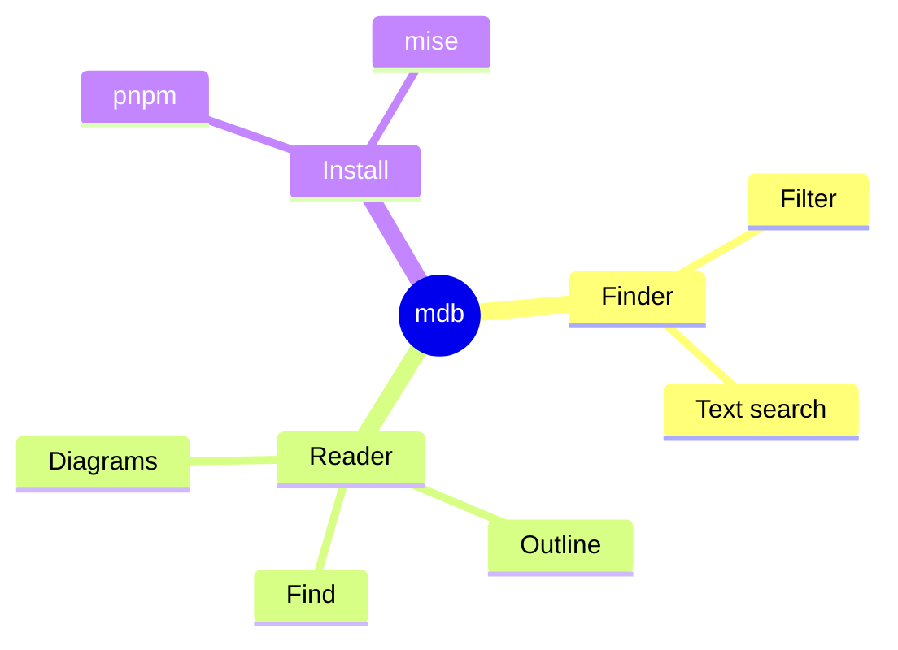

### Timeline

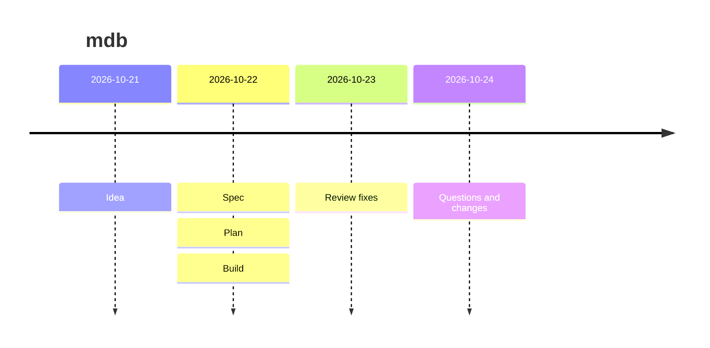

### User journey

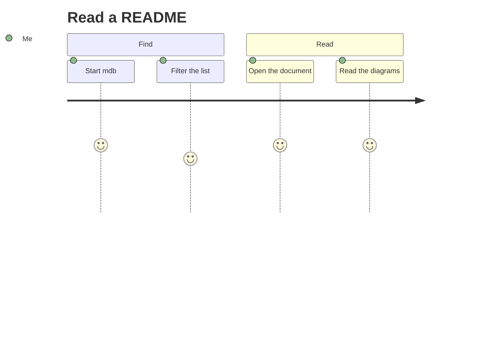

### Quadrant chart

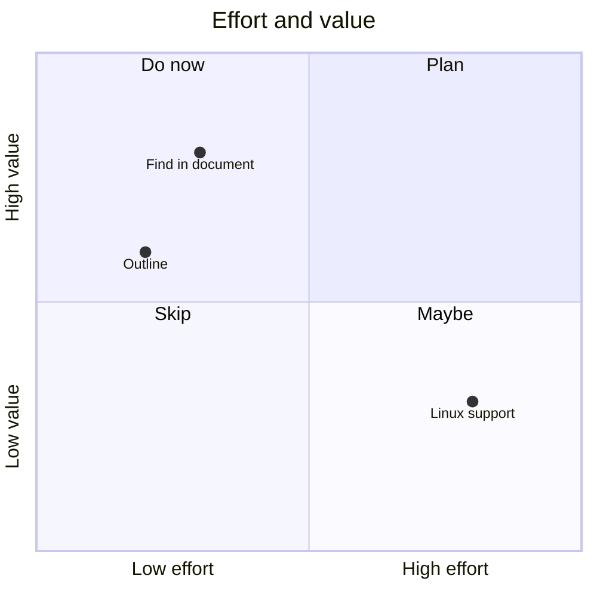

### XY chart

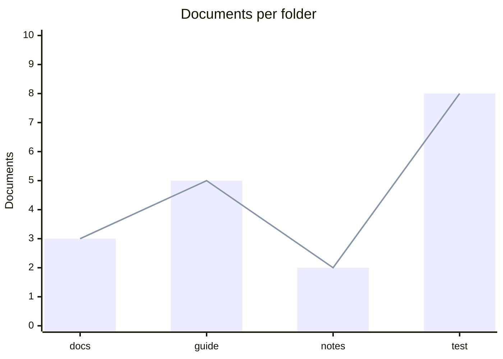

### A diagram with an error

mdb shows the diagram text and the error message:

```mermaid
flowchart LR
  A -->
```
