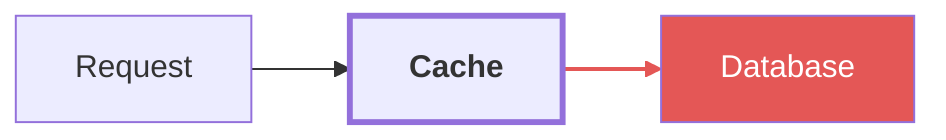

`mdb` is a markdown viewer that runs in the terminal. From your shell, it opens in a
new pane beside the user, so they can read the document while they talk to you.

## Show a document

```sh
mdb docs/plan.md
```

Your shell has no terminal, so mdb opens a pane to the right of the user's pane.
If this terminal tab already shows mdb, mdb opens the file in a new tab in that pane
instead of opening a new pane. If a tab there already shows the file, mdb goes to that
tab. Other agents in the same terminal tab can use the same pane, and each document keeps
its own tab. A folder opens its file list in a new tab in that pane.

Point the user at a section:

```sh
mdb docs/plan.md --heading "Open questions"
```

`--heading` matches the heading text without regard to case, or a heading id such as
`open-questions`. If no heading matches, mdb opens the top of the document and its status
line says "no heading matches". When mdb uses an existing pane, or opens a new pane for stdin,
the command also prints a warning; when it opens a new pane for a file, it does not.

Other options:

- `--split down` (or `left`, `up`) chooses where the new pane goes. The default is `right`.
- `--size 0.4` sets the size of a new pane, as a fraction of the current pane.
- `--new` opens a new pane even if the tab already shows mdb.
- `--replace` shows the file in the pane's current tab, not a new tab. Use it only when
  the new document replaces the one on screen.
- `mdb <folder>` opens the file list for a folder, where the user can search the markdown files.

mdb reloads the document when the file changes, also in a tab that the user does not see. After
you edit a file that mdb shows, you do not need to run mdb again. If you run mdb again for a file
that is open, mdb goes to its tab and does not open a copy; add `--heading` to point at the
section that you changed.

The command prints what it did: `opened … in a new pane`, `opened … in a tab in the mdb pane`,
`switched to … in the mdb pane`, `showing … in the mdb pane`, or `updated … in the mdb pane`.

A tab shows the title of its document: the frontmatter `title`, else the first `# heading`, else
the file name. Give each document that you write a clear title, so that the user can tell the
tabs apart.

## Show markdown without a file

Pipe markdown into `mdb -`. mdb reads stdin until it ends. If it has not ended after 2 seconds,
mdb writes `mdb: reading stdin until it ends`. mdb writes no file, and the text is gone when the user closes the
tab. Relative links and images start from your current folder.

```sh
gh pr view 1 --json body -q .body | mdb -
```

To keep a running summary of your work, give it a title. After each step, pipe the full summary
again:

```sh
cat <<'MD' | mdb --title "Work summary"
# Work summary

- Added the parser.
- Next: the tests.
MD
```

A pipe with the same title updates that tab in place, with its scroll position kept. mdb does
not switch to the tab. If the user does not see the tab, it gets a dot. Add `--heading` to bring the tab to the front at a
section. Use one title for one document.

A bare `mdb` with no file or folder reads a pipe on stdin. Do not run it with other text on
stdin.

## When to use it

- You wrote or changed a document that the user should read: a plan, a spec, release notes.
- The user asks to see a markdown file, or a document has diagrams, tables, or images that do
  not read well as text.

Do not use it for short answers. Tell the user in one line what you opened, for example
"I opened the plan in mdb, at Open questions."

## Diagrams

mdb draws Mermaid diagrams in the colors of the terminal. To make a part of a flowchart
easy to see, give it a style:



- Use `style`, `classDef` with `class`, and `linkStyle`.
- Use styles only in `flowchart` (or `graph`) diagrams. Other diagram types, such as
  `sequenceDiagram`, do not accept these lines, and mdb shows an error instead of the diagram.
- Charts, such as `pie`, get their colors from mdb. You cannot change these colors.
- Do not use `%%{init}%%`. mdb ignores it.
- Use color only to show what is important, for example the changed part, the risk, or the
  path that you talk about. Do not color all nodes.
- The user's terminal can have a dark or a light background. When you set `fill`, also set
  `color`, so that the text is easy to read.

## If it fails

- `cannot open panes`: the terminal cannot be scripted. Ask the user to run the `mdb` command
  themselves.
- `did not start in it`: the new pane opened, but mdb did not start in it. Ask the user what
  the new pane shows.

Run `mdb --help` for the full list of options.
