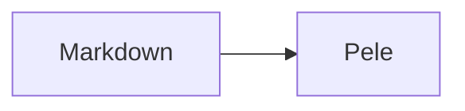

# Fixture Docs

A sample folder for mdb tests. See the [setup guide](guide/setup.md) and the [install step](guide/setup.md#install).

## Table

| Name | Value |
| ---- | ----: |
| one  |     1 |
| two  |     2 |

## Tasks

- [x] write tests
- [ ] ship it

## Notes

Here is a footnote reference.[^1]

[^1]: The footnote text.

> [!NOTE]
> Useful information.

> [!WARNING]
> Be careful.

> A plain quote.

## Code

```ts
const answer: number = 42;
```



## Images


<script>alert(1)</script>

<details><summary>More</summary>Hidden text.</details>

## Notes

Duplicate heading text on purpose.

Visit https://example.com or [missing](missing.md).
